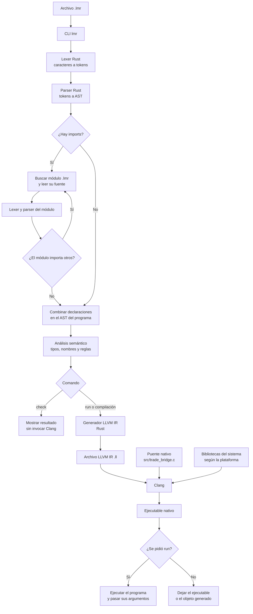

# Arquitectura y flujo de LMR

LMR es un lenguaje compilado. El ejecutable `lmr` está escrito en Rust y hace de controlador del proceso: procesa el comando, analiza el programa y coordina la carga de módulos. El backend genera LLVM IR y Clang lo enlaza con el puente nativo cuando se necesita un ejecutable.

## De código fuente a programa

## Resolución de imports

El cargador convierte el nombre del módulo a una ruta `.lmr` y busca en este orden:

1. La carpeta del programa y sus subcarpetas `modules/`.
2. Las carpetas configuradas en `LMR_MODULE_PATH`.
3. La carpeta de módulos del usuario.
4. Los módulos junto a la distribución o al compilador.

Cada módulo se tokeniza y analiza igual que el archivo principal. Sus imports se cargan recursivamente y el cargador evita procesar dos veces el mismo nombre de módulo. Las declaraciones se agregan al programa antes del análisis semántico.

## Modos de uso

- `lmr check archivo.lmr`: lexer, parser, carga de imports y análisis semántico. No genera LLVM IR ni llama a Clang.
- `lmr run archivo.lmr`: ejecuta el flujo completo y arranca el ejecutable que produce Clang.
- `lmr archivo.lmr`: compila el archivo a un ejecutable, sin ejecutarlo.
- `lmr archivo.lmr -c`: pide a Clang generar un archivo objeto.

El puente `src/trade_bridge.c` expone funciones nativas que usan algunos módulos. Clang lo incluye al enlazar ejecutables. También enlaza las bibliotecas de plataforma necesarias para esas funciones y para las capacidades gráficas disponibles en Windows.

## Componentes del repositorio

| Componente | Responsabilidad |
|---|---|
| `src/main.rs` | CLI, flujo de compilación, búsqueda y carga recursiva de módulos, invocación de Clang y ejecución. |
| `src/lexer.rs` y `src/token.rs` | Reconocer tokens del código fuente. |
| `src/parser.rs` y `src/ast.rs` | Analizar la sintaxis y representar el programa como AST. |
| `src/sema.rs` | Comprobar nombres, tipos y reglas semánticas antes de generar código. |
| `src/codegen.rs` | Traducir el AST a LLVM IR. |
| `src/trade_bridge.c` | Implementaciones nativas para funciones enlazadas desde programas LMR. |
| `modules/` | Módulos fuente que se pueden importar desde programas LMR. |
| `lmr-vscode/` | Resaltado y herramientas básicas de edición para archivos `.lmr`. |

## Límite actual

El flujo depende de Clang para enlazar el programa generado. Por eso `lmr check` puede revisar un programa sin Clang, mientras que generar y ejecutar un binario requiere que Clang esté instalado y disponible en `PATH`. La disponibilidad de funciones nativas y módulos puede variar por plataforma; consulta el manifiesto y la guía del lenguaje.
